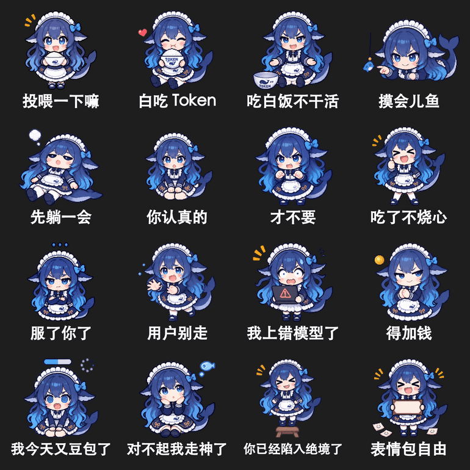
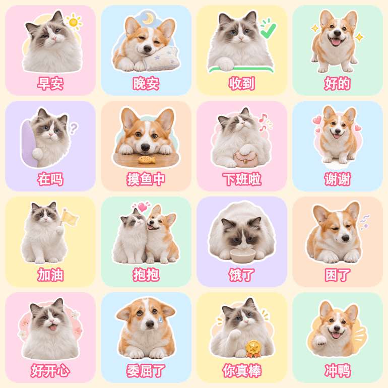
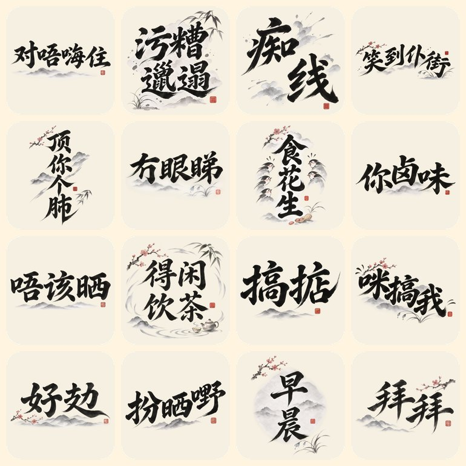
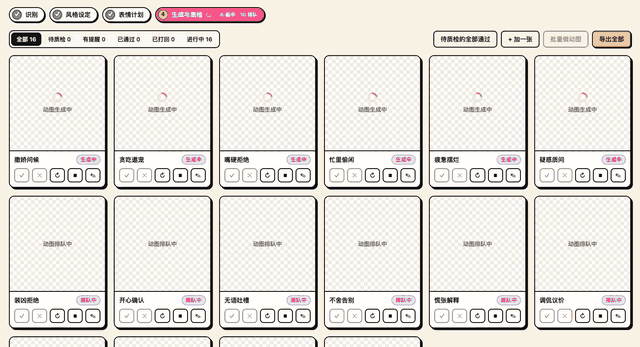
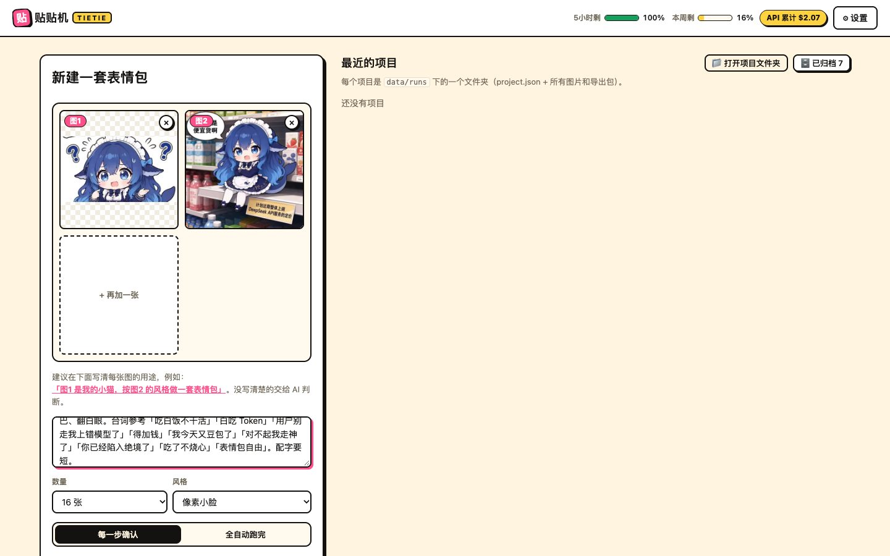
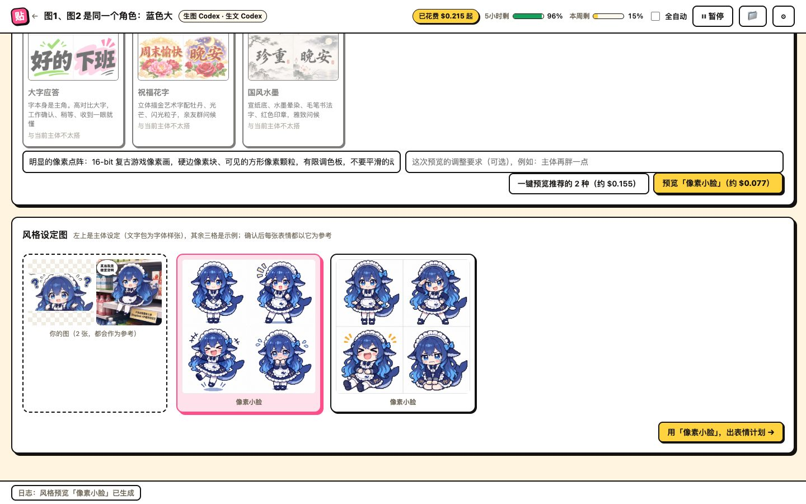
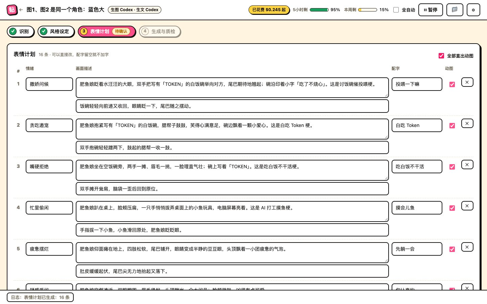
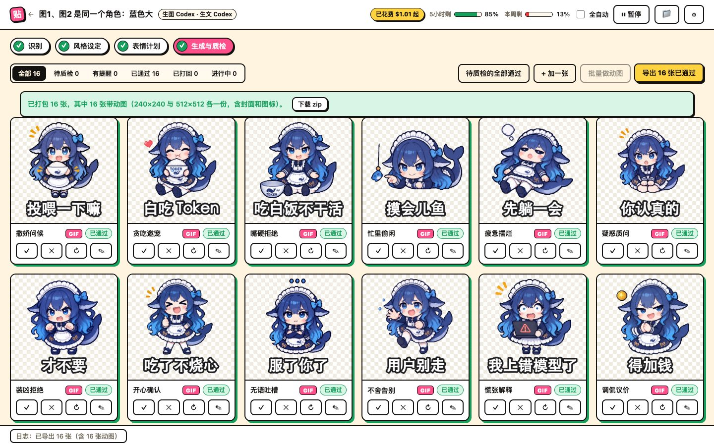

<div align="center">


# 贴贴机 TIETIE

**一张图 + 一句话，做出一整套微信表情包**

识别 → 定风格 → 出计划 → 批量生成 → 质检修改 → 导出，全在你自己电脑上跑

[](LICENSE) [](docs/install.md) [](docs/install.md)

[快速开始](#-快速开始) · [三套 Demo](#-三套-demo) · [怎么做出来的](#-怎么做出来的) · [使用说明](docs/guide.md) · [安装与配置](docs/install.md)

</div>

https://github.com/user-attachments/assets/5b1060c4-f297-4031-bd52-44261a633c33

<p align="center"><sub>85 秒演示：从上传到导出，再看三套成品</sub></p>

## ✨ 能做什么

- 🖼️ **有图没图都行**：传 1–4 张角色、宠物或参考图；不传就按描述原创形象，也能做纯文字包
- 🎨 **先定风格再开画**：14 种风格一键预览 2×2 设定图，并排对比，选定后整套保持一致
- 📝 **AI 帮你写计划**：每张的情绪、画面、配字、动作都列好，想改哪条改哪条
- 🎞️ **静图、动图都能出**：直出透明 GIF，微信深色模式下也没有白边
- 🔍 **边生成边质检**：多张并发，单张可以改字、局部修改、重画、切历史版本
- 📦 **一键导出微信规格**：240 / 512 成品、封面、图标，打成一个 zip
- 💳 **用订阅就能跑**：默认走 ChatGPT 的 Codex 订阅；也可以接自己的 API

## 🚀 快速开始

把仓库链接发给 **Codex**、**Claude Code** 或你常用的编程 Agent，说一句：

```text
帮我安装并启动贴贴机：https://github.com/yikanw/tietie-sticker-studio
```

Agent 会照着仓库里的 [AGENTS.md](AGENTS.md) 装好依赖、启动服务，然后打开 <http://localhost:5177> 就能用。

> 需要你自己做的只有两件事：用 ChatGPT 账号登录 Codex；想做动图的话，在「设置 → 生图」里填一个 OpenAI API Key。

想手动安装，或者接第三方 / 本地模型，见 [安装与配置](docs/install.md)。

## 🎬 三套 Demo

每套 16 张，都是贴贴机生成的，没有修图。

<table>
<tr>
<th width="33%">像素肥鱼娘 · AI 梗</th>
<th width="33%">布偶猫 × 柯基 · 日常语录</th>
<th width="33%">国风粤语 · 文字</th>
</tr>
<tr>
<td></td>
<td></td>
<td></td>
</tr>
<tr>
<td>2 张角色图 + 一段 AI 梗，像素风，<b>16 张直出透明动图，约 3 分钟</b></td>
<td>不传图，真实萌宠头像 + 白描边 + 糖果色底，<b>静图再批量做成动图</b>，配字跳动</td>
<td>纯文字包，水墨书法 + 宣纸底：对唔嗨住、食花生、得闲饮茶…</td>
</tr>
</table>

## 🧭 怎么做出来的

以第一套为例，整套流程在网页里点完：



| ① 上传 + 一句想法 | ② 预览对比风格 | ③ 改计划、勾动图 | ④ 通过、导出 |
|:---:|:---:|:---:|:---:|
|  |  |  |  |
| 拖图、粘贴都行，写清想要的梗 | 不够像素？补一句再出一张 | 配字改成梗原句，一键全部动图 | 不满意的单张重画，再一键打包 |

每一步都能停下来改，也可以选「全自动」一路跑完。更多玩法见 [使用说明](docs/guide.md)。

## 💰 花多少钱

- **Codex 订阅**：用你 ChatGPT 套餐里的额度，页面顶部实时显示剩余
- **API**：一张静图约 $0.06，一张动图约 $0.05；批量生成前会先弹出预计费用

## 📚 文档

- [使用说明](docs/guide.md)：四个步骤的细节、单张修改、导出内容、风格开关
- [安装与配置](docs/install.md)：手动安装、生图 / 生文通道、自定义 API、费用计算
- [演示视频工程](demo-video/README.md)：用 Remotion 把录屏剪成演示视频
- [更新记录](CHANGELOG.md)

## 📄 许可

[MIT](LICENSE)

第一套 Demo 的形象是网络二创角色，仅作功能演示。生成的表情包上架前，请自行确认没有侵犯他人的肖像、商标或版权形象。
